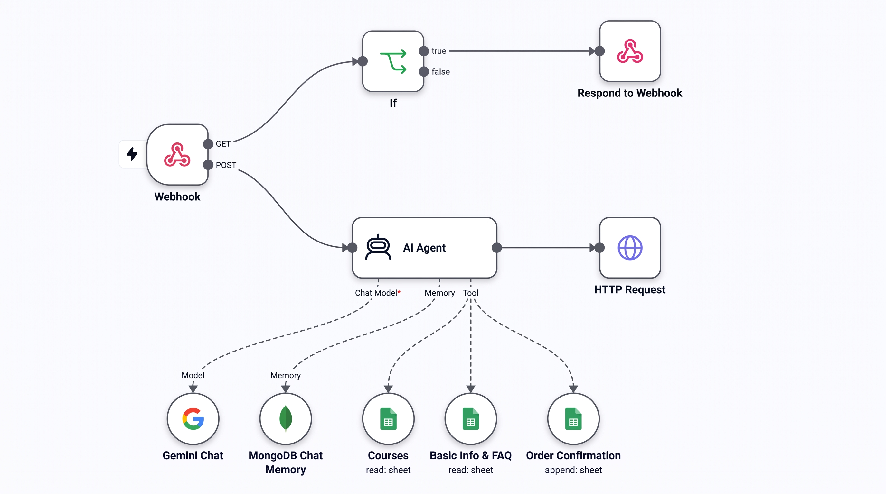
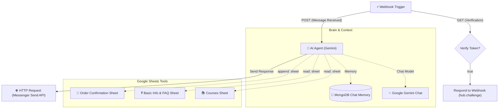

# 🤖 Messenger AI Agent - Intelligent Message Automation

[](https://n8n.io/)
[](https://ai.google.dev/)
[](https://www.mongodb.com/)
[](https://sheets.google.com/)

A full agentic AI automation workflow built in **n8n** to automate Facebook Messenger communications. The agent leverages **Google Gemini** as its reasoning engine, stores conversational context in **MongoDB**, dynamically retrieves course and FAQ information from **Google Sheets**, logs incoming orders/leads, and replies directly to users via the Facebook Messenger API.

---

## 📌 Architecture & Workflow



### Workflow Pipeline



---

## ✨ Key Features

- **Automated Webhook Handshake**: Handles Meta's webhook verification (`GET` request with challenge token validation) out of the box.
- **Conversational Memory**: Powered by **MongoDB Chat Memory**, retaining past messages for seamless, context-aware multi-turn conversations.
- **Dynamic Knowledge Retrieval**:
  - **Courses Information**: Reads real-time syllabus, schedules, and pricing from a Google Sheet.
  - **Basic Info & FAQ**: Resolves customer inquiries using a centralized FAQ Google Sheet.
- **Order & Lead Capture**: The AI Agent can autonomously register student enrollments or orders by appending data directly to an **Order Confirmation** Google Sheet.
- **Messenger Reply Dispatcher**: Uses an HTTP Request node configured for Meta's Send API to deliver formatted responses back to the recipient.

---

## 🛠️ Tech Stack & Integrations

| Component | Technology / Service | Role |
| :--- | :--- | :--- |
| **Workflow Engine** | [n8n](https://n8n.io/) | Orchestration and pipeline execution |
| **AI LLM** | Google Gemini (`Gemini Chat`) | Natural language understanding and reasoning |
| **Session Memory** | MongoDB (`MongoDB Chat Memory`) | Conversation history persistence per sender |
| **Knowledge Base** | Google Sheets | Live data lookup for Courses and FAQs |
| **Data Logging** | Google Sheets | Capturing orders, leads, and student data |
| **Channel** | Meta / Facebook Messenger API | Inbound webhook trigger and outbound messages |

---

## 📋 Prerequisites

Before importing and activating the workflow, make sure you have:

1. **n8n Instance**: Self-hosted (Docker/npm) or n8n Cloud (v1.x+ recommended).
2. **Meta for Developers Account**:
   - A Facebook Page.
   - A Facebook App with the **Messenger API** configured.
   - Page Access Token and App Secret / Verification Token.
3. **Google Gemini API Key**:
   - An API key generated via [Google AI Studio](https://aistudio.google.com/).
4. **MongoDB Instance**:
   - A connection string (e.g., MongoDB Atlas or local MongoDB instance) for conversation memory.
5. **Google Cloud / Google Sheets Credentials**:
   - OAuth2 or Service Account credentials in n8n with Google Sheets read/write permissions.

---

## ⚙️ Setup & Configuration

### 1. Webhook Setup (Meta Messenger)
1. In the **Webhook** node, copy the **Production Webhook URL**.
2. Go to your **Meta App Dashboard > Messenger > Webhooks**:
   - Paste the Webhook URL.
   - Enter your designated **Verify Token**.
3. In the workflow's **If** node:
   - Ensure the condition checks whether `hub.verify_token` matches your secret verification token.
   - In the **Respond to Webhook** node, return the `hub.challenge` query parameter.

### 2. Configure Credentials in n8n
Set up the following credentials in your n8n workspace:
- **Google Gemini**: Add your Gemini API Key.
- **MongoDB**: Provide your connection URI (e.g., `mongodb+srv://...`) and specify database/collection names for message logs.
- **Google Sheets**: Authenticate using your Google OAuth or Service Account.

### 3. Connect Google Sheets Tools
Ensure the three Google Sheet nodes are pointed to your target spreadsheets:
- **Courses Tool (`read: sheet`)**:
  - Columns: `Course Name`, `Details`, `Fee`, `Duration`, `Batch Date`, etc.
- **Basic Info & FAQ Tool (`read: sheet`)**:
  - Columns: `Question`, `Answer`, `Category`, `Keywords`.
- **Order Confirmation Tool (`append: sheet`)**:
  - Columns: `Timestamp`, `User PSID`, `User Name`, `Course Selected`, `Phone Number`, `Payment Status`.

### 4. HTTP Request (Send Message)
- Configure the node with:
  - **Method**: `POST`
  - **URL**: `https://graph.facebook.com/v19.0/me/messages`
  - **Authentication**: Header Auth or Query Parameter with your `PAGE_ACCESS_TOKEN`.
  - **JSON Body**:
    ```json
    {
      "recipient": {
        "id": "={{ $json.sender.id }}"
      },
      "message": {
        "text": "={{ $json.output }}"
      }
    }
    ```

---

## 🚀 How It Works (Flow of Operation)

1. **User sends a message** to your Facebook Page.
2. Meta forwards the payload to the n8n **Webhook** (`POST`).
3. The **AI Agent** receives the prompt and:
   - Fetches recent chat history from **MongoDB**.
   - Evaluates user intent with **Google Gemini**.
   - Calls the relevant tool:
     - Inquiries about courses $\rightarrow$ queries **Courses Sheet**.
     - General questions $\rightarrow$ queries **Basic Info & FAQ Sheet**.
     - Purchase or registration intent $\rightarrow$ collects info and appends to **Order Confirmation Sheet**.
4. The agent's final text response is forwarded to the **HTTP Request** node.
5. The message is sent back to the user on Messenger via the Meta Graph API.

---

## 👤 Author

- **Sajidul Islam**
- GitHub: [@sajidsam](https://github.com/sajidsam)
- Repository: [MessengerAgent](https://github.com/sajidsam/MessengerAgent)

---

## 📄 License

This project is licensed under the [MIT License](LICENSE).
